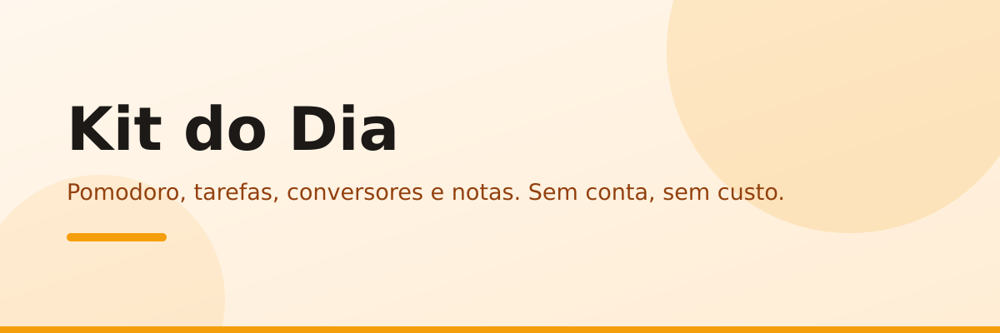

<div align="center">

[](https://github.com/Wagner-Schemmer/kit-do-dia/stargazers)
[](https://kit-do-dia.vercel.app)


  <a href="https://kit-do-dia.vercel.app"></a>

  <h1>Kit do Dia</h1>

  <p>
    <b>Pomodoro, tarefas, conversores e notas. Sem conta, sem custo.</b>
    <br />
    Tudo salvo no navegador (`localStorage`). Abra e use — até offline.
  </p>

  <p>
    <a href="https://kit-do-dia.vercel.app"><b>Demo</b></a> ·
    <a href="#o-que-cada-modulo-faz">Módulos</a> ·
    <a href="#como-rodar">Como rodar</a> ·
    <a href="#como-se-compara">Comparar</a> ·
    <a href="#stack">Stack</a>
  </p>
</div>

<a href="https://kit-do-dia.vercel.app"></a>

O Kit do Dia junta as 4 ferramentas que você abre todo dia em uma página só: pomodoro com ciclos, lista de tarefas com prioridades, conversores com cotação ao vivo e bloco de notas com auto-save.

## O que cada módulo faz

| Módulo | O que faz | Onde salva |
|---|---|---|
| **Pomodoro PRO** | Tempos editáveis, troca automática foco ⇄ pausa, notificações, som WebAudio, foco do dia + sequência 🔥 | ✓ `localStorage` |
| **Tarefas** | Prioridades 🔴🟡🟢, busca, filtros, limpar concluídas | ✓ `localStorage` |
| **Conversores** | Moeda BRL→USD/EUR com **cotação online ao vivo** (fallback manual), temperatura, km→mi, kg→lb | ✓ preferência local |
| **Notas** | Auto-save com hora, contador de palavras, download `.txt` | ✓ `localStorage` |
| **Extras** | Saudação por horário, PWA instalável, toasts, 100% responsivo | — |

## Como se compara

| | Apps de produtividade comuns | Kit do Dia |
|---|---|---|
| Precisa criar conta | Quase sempre | **Não** |
| Tem anúncio / paywall | Frequentemente | **Não** |
| Funciona offline | Raramente | **Sim (PWA)** |
| Código aberto | Raramente | **Sim** |

## Como rodar

1. Abra o `index.html` (Go Live no VSCode ou `python3 -m http.server` na pasta).
2. Inicie um pomodoro e adicione a tarefa do dia.
3. Instale como PWA e use até sem internet.

## Estrutura

```
kit-do-dia/
├── index.html      # markup + seções (pomodoro, tarefas, conversores, notas)
├── styles.css      # tema claro PRO
├── script.js       # ciclos, prioridades, cotação online, auto-save
├── manifest.json   # PWA instalável
└── api/            # health check p/ monitoramento
```

## Personalizar

1. Tempos do pomodoro e ciclos em `script.js`.
2. Moedas e unidades dos conversores em `script.js`.
3. Deploy: conectar o repo na Vercel (zero config).

## Stack

HTML · CSS · JavaScript (zero dependências, zero build).

## Quem faz

<a href="https://github.com/Wagner-Schemmer/kit-do-dia/graphs/contributors"></a>

## Star history

<a href="https://www.star-history.com/#Wagner-Schemmer/kit-do-dia&Date"></a>

---
Feito por [Wagner Schemmer](https://wagner-port.vercel.app) · [Portfólio](https://wagner-port.vercel.app) · [LinkedIn](https://www.linkedin.com/in/wagner-schemmer-martins-46950627a)
