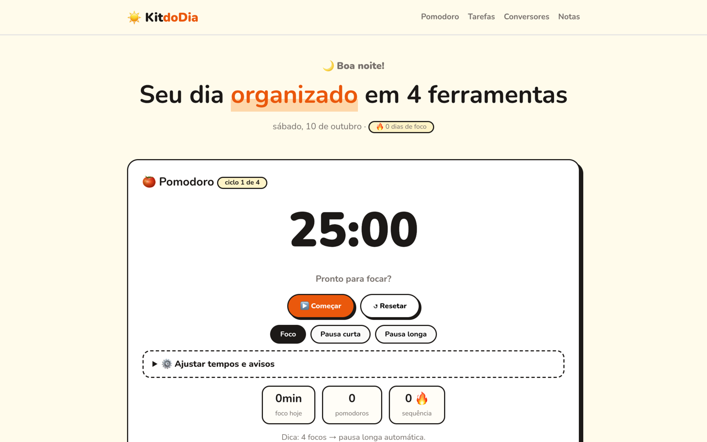

# ☀️ Bom dia! Aqui está seu kit de hoje

> **Previsão:** sem conta, sem anúncio, sem custo. Produtividade com céu limpo o dia todo.

[](https://kit-do-dia.vercel.app)

<a href="https://kit-do-dia.vercel.app"></a>

## Rotina sugerida

- [ ] **08:00 — Pomodoro PRO** ☕
  Tempos editáveis, troca automática foco ⇄ pausa, som WebAudio e sequência 🔥.
  Defina o *foco do dia* e aperte start.
- [ ] **09:00 — Tarefas** 📝
  Prioridades 🔴🟡🟢, busca e filtros. Concluiu? Risca da lista.
- [ ] **10:30 — Conversores** 💱
  BRL→USD/EUR com cotação ao vivo, temperatura, km→mi, kg→lb.
- [ ] **17:00 — Notas** 🌙
  Descarregue o dia: auto-save, contador de palavras, download `.txt`.

## Onde fica tudo

Na sua máquina, em `localStorage`. Fechou o navegador, continua lá. Trocou de aparelho, começa do zero — por design, não por bug.

## Servir o café (rodar local)

```bash
git clone https://github.com/Wagner-Schemmer/kit-do-dia.git
cd kit-do-dia && python3 -m http.server
# → http://localhost:8000
```

Na cozinha: `index.html` · `styles.css` · `script.js` · `manifest.json` (PWA — instale e use offline).

## Personalizar o cardápio

Tempos e ciclos do pomodoro e moedas dos conversores moram em `script.js`. Deploy é conectar o repo na Vercel.

---
Feito antes do café por [Wagner Schemmer](https://wagner-port.vercel.app) · [Portfólio](https://wagner-port.vercel.app)
